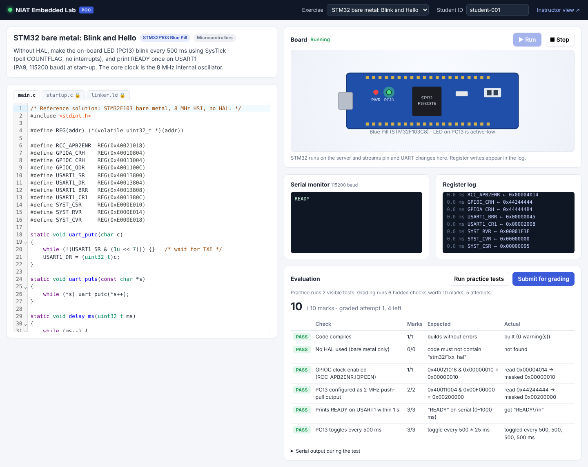

# NIAT Embedded Lab: Simulator POC

A working proof of concept for the PRD *"NIAT Online Embedded Simulator with Auto-Evaluation"*.
A student opens an exercise, writes code, runs it on a virtual board, and submits it for automatic grading against hidden tests. Instructors see scores in a gradebook.

It covers the PRD's core loop for two boards:

| Board | Code | Live run | Grading |
|---|---|---|---|
| **STM32F103 Blue Pill** | Bare-metal C (registers, own startup + linker script, no HAL) | On the server, streamed to the board view over WebSocket | Server, same engine |
| **Arduino Uno** | Arduino sketch | Fully in the browser (avr8js) | Server, same avr8js core |

ESP32 is **not** in this POC (see "Next steps").



---

## Open in Codespaces (no install)

[](https://codespaces.new/saitejamanchukanti104/niat-sim-poc?quickstart=1)

The Codespace installs everything and opens the lab in a browser tab. First start takes about 3–5 minutes. Then follow `START-HERE.md`.

## Quick start (local)

Requirements (Ubuntu 24.04 tested): Node 22, Python 3.10+, `gcc-arm-none-eabi`, `libnewlib-arm-none-eabi`, `gcc-avr`, `avr-libc`, `binutils-avr`.

```bash
sudo apt-get install -y gcc-arm-none-eabi libnewlib-arm-none-eabi gcc-avr avr-libc binutils-avr
pip install unicorn pyyaml          # add --break-system-packages on Ubuntu 24.04 if needed
npm install
npm run build                       # bundles the web UI into web/public/app.js
npm start                           # http://localhost:8080
```

- Student view: `http://localhost:8080`
- Instructor view: `http://localhost:8080/instructor.html`
- Grader self-test: `npm run selftest`
- Headless UI check + screenshots (needs Chrome): `node scripts/ui-check.js`

A `Dockerfile` is included for convenience. It was **not built** in the environment where this POC was made (no Docker daemon there).

---

## Try it in 2 minutes

1. Pick **STM32 bare metal: Blink and Hello**. Paste `exercises/stm32-blink-hello/solution/main.c` into the editor, then click **Run**. READY appears, the PC13 LED blinks, and the register log shows every register write.
2. Delete `(1u << 4)` from the RCC line and **Run** again. The LED stays dark, and the log says the writes to GPIOC were ignored because its clock is off.
3. Click **Submit for grading**. You get marks for each check, with expected vs actual values and a hint for each failure.
4. Switch to **Arduino Uno: Button controls LED**, run the solution, and hold the green button. LED "L" lights and PRESSED prints.
5. Open the **Instructor view** to see the gradebook and the Renode translation of the STM32 tests.

---

## How it maps to the PRD

| PRD item | POC status |
|---|---|
| F1 Code editor, read-only files | Done: CodeMirror 6, locked `startup.c` / `linker.ld` |
| F2 Board canvas | Done: wokwi-elements Uno + pushbutton, custom SVG Blue Pill |
| F3 Server compile | Done: `arm-none-eabi-gcc` and `avr-g++`, temp folder per build, 20 s limit |
| F4 Live run with visuals + inputs | Done: STM32 over WebSocket, Uno in the browser, button input |
| F5 Practice runs (visible tests) | Done |
| F6 Graded runs (hidden tests, attempt limit) | Done: hidden tests never leave the server, 5 attempts |
| F7 Results: expected vs actual, hints, serial log | Done |
| F8 Gradebook | Done: JSON file (`data/gradebook.json`) + instructor page. No real LMS link |
| F9 Authoring UI | Not built: exercises are YAML files on disk (see "Add an exercise") |
| F10 Step-through debugging (GDB) | Not built (Phase 3) |
| F11 Register access log (STM32) | Done |
| F12–F17 | Not built |
| Section 4 engine-neutral test file | Done: one YAML format for both boards |
| Section 3 Renode for STM32 | Partly: see "STM32 engine" below |
| Section 5 sandboxing | Partly: temp folders + time limits only. Production needs containers |

---

## Architecture

```
web/ (browser)                       server/ (Node)                         engines/
 editor + board canvas  ── REST ──▶  /api/build, /api/evaluate  ──▶  grader.js ──▶ engine.runBatch()
 Uno: avr8js in browser              /api/gradebook, /renode                       ├─ stm32_engine.py (Python)
 STM32: board view  ◀── WebSocket ──  /ws/live  ──▶  engine.startLive()            └─ shared/uno-core.js (avr8js)
```

| Path | What it is |
|---|---|
| `server/index.js` | Express API + WebSocket live sessions |
| `server/build.js` | Compile service (STM32 + Uno) |
| `server/grader.js` | Test-file evaluator (all check types) |
| `server/engines/index.js` | Engine adapters behind one contract; **swap point for Renode** |
| `server/renode-export.js` | Translates a test file into Renode `.repl` + Robot Framework suite |
| `engines/stm32_engine.py` | POC STM32F103 engine (see below) |
| `shared/uno-core.js` | Uno engine core, used by both browser and server |
| `toolchains/` | STM32 startup + linker script; Arduino-lite for the Uno |
| `exercises/<id>/` | `exercise.yaml`, `starter/`, `solution/`, `wrong/`, `tests.visible.yaml`, `tests.hidden.yaml` |
| `web/` | UI source (`web/src/app.js`) and static files (`web/public/`) |
| `scripts/` | `selftest.js`, `ui-check.js`, `build-web.js` |

### Engine contract

Every engine produces the same events, so grading and the UI do not care which engine runs:

```
{"ev":"gpio","t":ms,"pin":"PC13","v":0|1}
{"ev":"uart","t":ms,"port":"usart1","data":"R"}
{"ev":"reglog","t":ms,"op":"W","reg":"RCC_APB2ENR","addr":"0x40021018","val":"0x00004014"}
{"ev":"warn","t":ms,"msg":"..."}        {"ev":"fault","t":ms,"msg":"...","pc":"0x..."}
{"ev":"end","t":ms,"regs":{"0x40021018":16404, ...}}
```

Adapters implement `runBatch(build, {durationMs, inputs})` for grading and `startLive(build, onEvent)` for live runs (see `server/engines/index.js`).

### STM32 engine: important

The PRD names **Renode** as the STM32 engine. Renode could not be installed in the environment where this POC was built, because downloads from GitHub, Docker Hub and builds.renode.io were blocked. So this POC uses a **stand-in**, `engines/stm32_engine.py`:

- It runs the real compiled firmware on an emulated Cortex-M3 (Unicorn), with RCC, GPIOA/B/C, USART1 and SysTick modelled.
- It enforces real behaviour students must learn: GPIO writes are ignored while the port clock is off, PA9 must be in alternate-function mode for UART, a wrong baud rate garbles output, and PC13 only drives when set as an output.
- **Limits:** timing counts 1 instruction as 1 cycle (not cycle-exact), there are **no interrupts** (labs must poll), and only the peripherals above are modelled. While code is only polling SysTick, the engine skips ahead in simulated time to keep runs fast.

**Production path:** write a `RenodeEngine` adapter with the same two methods, and point `stm32f103-bluepill` at it in `BOARD_ENGINES`. `server/renode-export.js` already generates the Renode platform file and Robot Framework suite from the same test YAML (see the instructor page). That template was **not executed** here. Check keyword names such as `Assert LED Is Blinking` against your Renode version.

---

## Test file format

One YAML file per exercise (`tests.hidden.yaml` for grading, `tests.visible.yaml` for practice):

| `type` | Fields | Notes |
|---|---|---|
| `compiles` | `marks` | |
| `static_forbid` / `static_require` | `pattern`, `on_fail: zero_total` | Checked before building |
| `serial_contains` | `text`, `after_ms`, `within_ms` | |
| `serial_count` | `text`, `expect` | Catches "printed in a loop" bugs |
| `set_input` | `pin`, `value`, `at_ms` | A step, not scored. Drives a button or pin |
| `pin_state` | `pin`, `value`, `at_ms` | |
| `pin_toggle_period` | `pin`, `expect_ms`, `tolerance_ms`, `samples` | |
| `register_bits` | `address`, `mask`, `expect` | STM32 only, read at end of run |

Every check can have `title` and `hint`; the hint is shown when the check fails. Pins are named `PC13` (STM32) or `D13` (Uno).

## Add an exercise

1. Copy `exercises/stm32-blink-hello` (or the Uno one) to a new folder.
2. Edit `exercise.yaml` (`id`, `title`, `board`, `editable`, `task`, `attempts`, `duration_ms`).
3. Write `starter/`, `solution/`, `wrong/` (a typical mistake) and both test files.
4. Add the expected failing check for `wrong/` in `scripts/selftest.js`, then run `npm run selftest`. The solution must score full marks and the wrong version must lose marks.

---

## Verified in this build

- `npm run selftest`: both reference solutions score 10/10. The known-wrong STM32 solution (1000 ms blink) scores 7/10 and fails on timing. The known-wrong Uno solution (prints PRESSED every loop) scores 9/10, printing 6 times instead of once. Starter code scores 1/10 on both.
- `scripts/ui-check.js` in headless Chrome: the live STM32 run shows READY and blinks PC13. The forgot-clock mistake shows the warning in the register log. The live Uno run lights LED 13 on button press. Graded attempts land in the gradebook. Screenshots are in `docs/screenshots/`.

## Next steps (from the PRD plan)

1. Replace the STM32 stand-in with Renode (adapter + generated Robot suite), and add the STM32F4 Discovery.
2. Add ESP32 through Espressif's QEMU with the same engine contract.
3. Run builds and engines in throwaway containers (no network, CPU/memory caps) behind a job queue.
4. Replace Arduino-lite with arduino-cli and the official cores. Arduino-lite supports only `pinMode`, `digitalWrite`, `digitalRead`, `millis`, `delay` and basic `Serial` printing, and functions must be declared before use.
5. Connect the gradebook to the LMS, add authentication, an authoring UI (F9) and GDB debugging (F10).

`window.niatLab` in `web/src/app.js` is a test hook used by `scripts/ui-check.js`; remove it for production.
